# Benchmark summary

- GPU: **NVIDIA L40S** (46068 MiB), driver 580.178.04 (CUDA 13.0)
- vLLM: `0.27.0` image `vllm/vllm-openai:v0.27.0`
- client: scw-objective-ganguly @ scaleway/pl-waw-2
- KV cache: **24912 tokens**, cold start **198 s**, announced max concurrency 3.04x

## vllm
_network latency to target: connect >= 0.000 s, TTFB >= 0.001 s (client scw-objective-ganguly @ pl-waw-2)_

| conc | completed/total | err% | 429 | TTFT p50/p95 (ms) | per-token p50/p95 (ms) | out tok/s | mean out tok |
|---|---|---|---|---|---|---|---|
| 1 | 50/50 | 0.0 | 0 | 300.8/304.4 | 50.76/50.77 | 19.3 | 256 |
| 8 | 50/50 | 0.0 | 0 | 1182.8/1953.7 | 58.22/60.36 | 117.3 | 256 |
| 16 | 64/64 | 0.0 | 0 | 1713.8/4093.6 | 66.13/71.43 | 217.1 | 256 |
| 32 | 128/128 | 0.0 | 0 | 5272.3/23655.7 | 78.77/115.57 | 224.1 | 256 |
| 64 | 256/256 | 0.0 | 0 | 46085.3/48887.9 | 78.26/124.72 | 236.1 | 256 |
| 128 | 512/512 | 0.0 | 0 | 112403.3/121676.4 | 78.41/126.18 | 241.0 | 256 |

## Cost

Self-hosted price assumed: **1.47 EUR/h** (L40S). Cost/Mtok(out) = price_per_hour / (output_throughput x 3600) x 1e6.

| conc | out tok/s | self-host EUR / Mtok(out) |
|---|---|---|
| 1 | 19.3 | 21.172 |
| 8 | 117.3 | 3.482 |
| 16 | 217.1 | 1.881 |
| 32 | 224.1 | 1.822 |
| 64 | 236.1 | 1.730 |
| 128 | 241.0 | 1.694 |

Best measured output throughput: **241.0 tok/s** -> **1.694 EUR / Mtok(out)**.

Bedrock output price assumed: **0.6 USD / Mtok** (input 0.15 USD / Mtok).
Break-even sustained output throughput (self-host EUR/Mtok == Bedrock price, **treating the two currencies as equal — adjust for FX**): **680.6 tok/s**.
At the measured best throughput, self-hosting is **more expensive than** Bedrock per output token (same-currency assumption).

## Prediction vs measured

Measured facts to drop into findings/predictions.md:

- `kv_cache_tokens` = **24912**
- `cold_start_s` = **198**
- `floor_tpot_ms_c1` = **50.76**

## Charts

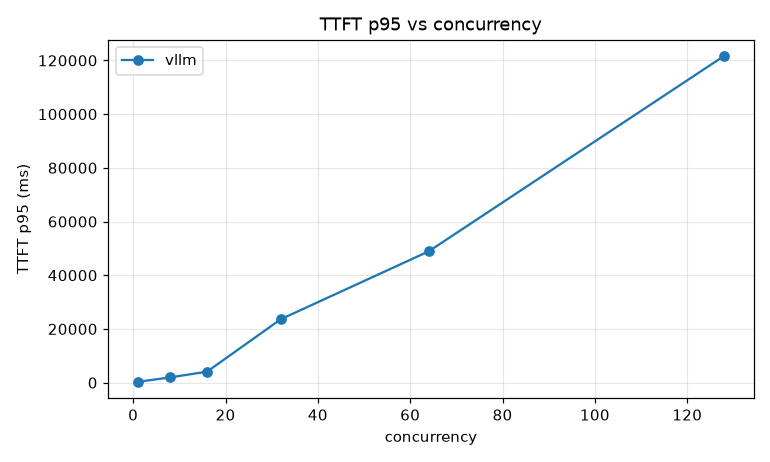

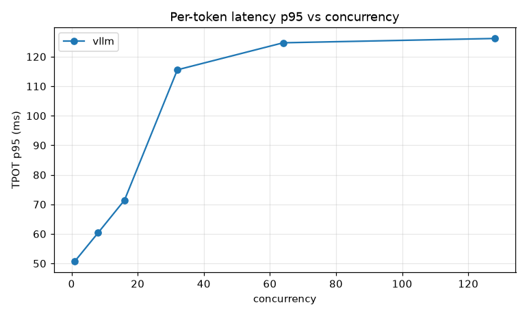

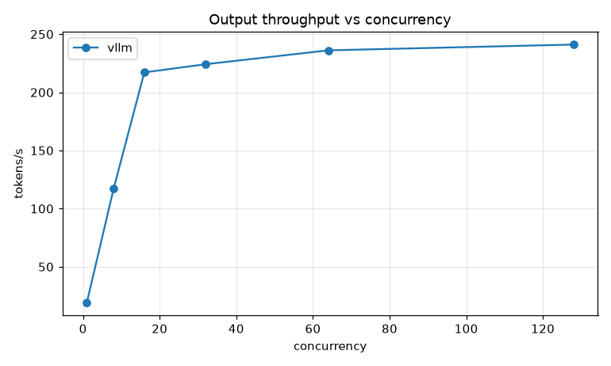

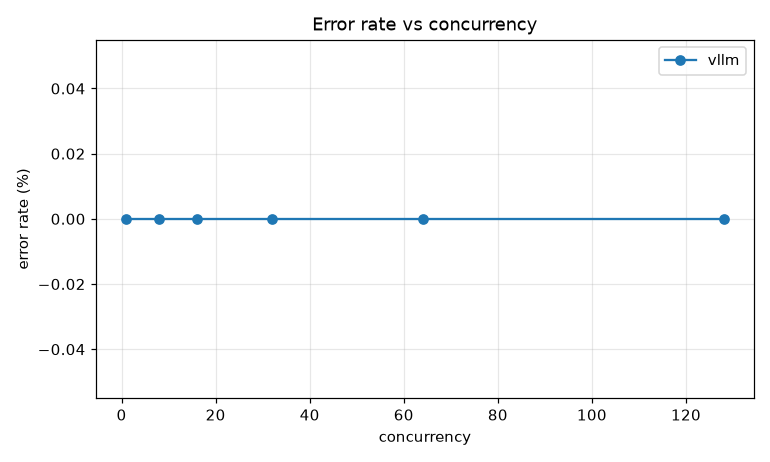

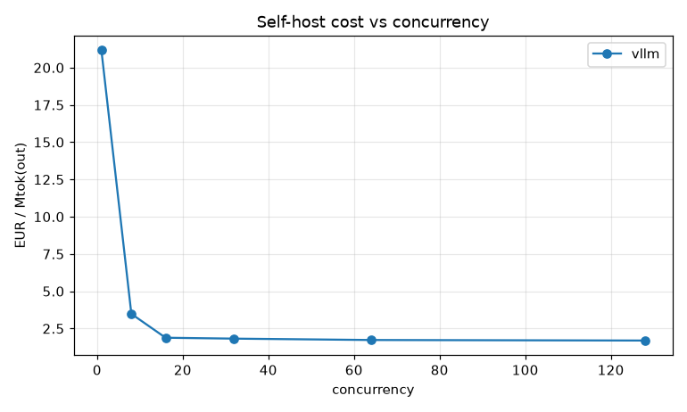

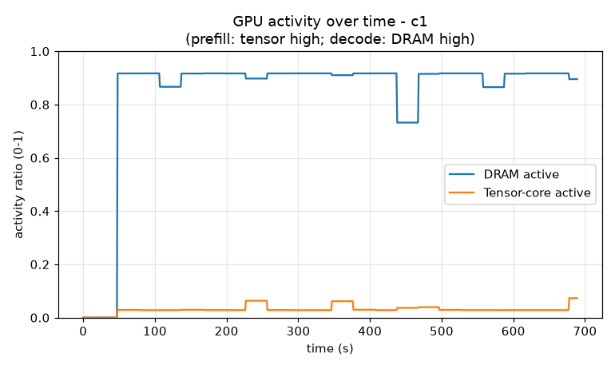

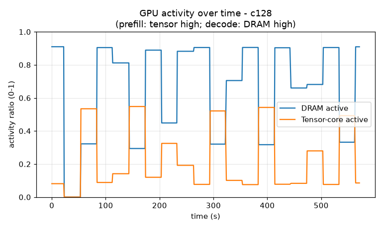

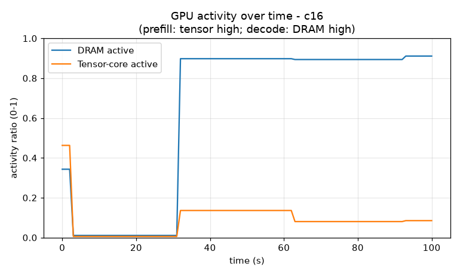

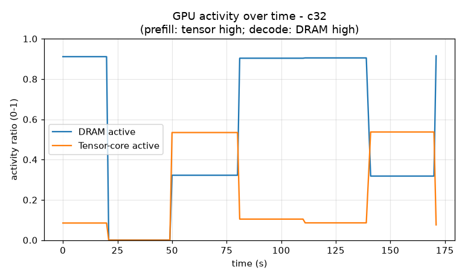

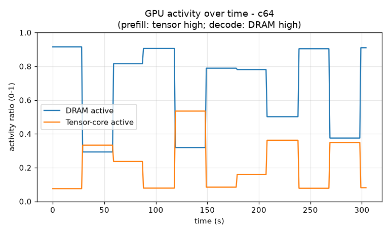

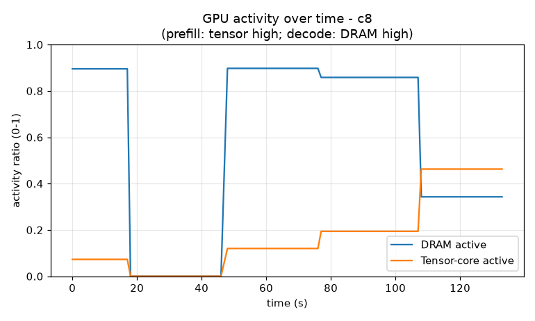

